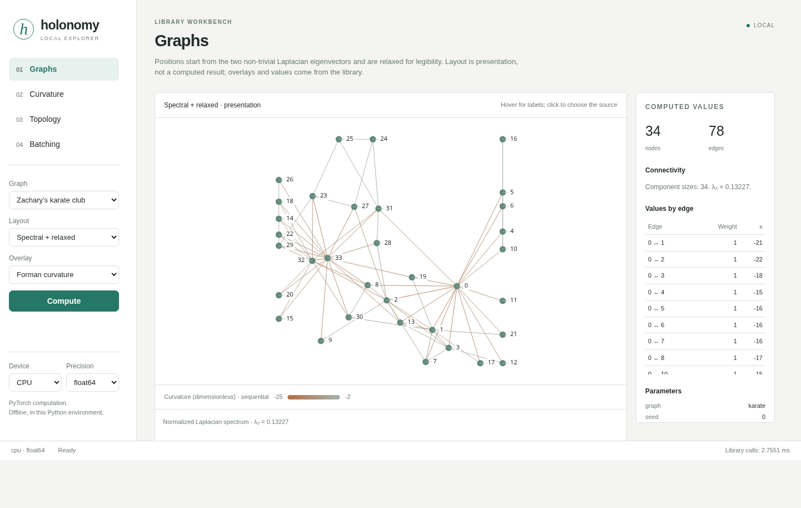

# holonomy_lib

Batched PyTorch primitives for Riemannian geometry, spectral graph theory,
discrete curvature, topology, and tensor decompositions. Version **0.8.0**.
Dense tensor operations take a leading batch dimension and use the device and
dtype of their inputs; sparse and sequential exceptions are described below.

## Install

Requires Python 3.12 or later.

```bash
pip install holonomy-lib
```

From a source checkout:

```bash
uv sync --extra dev
```

PyTorch determines hardware support: choose its build with the
[installation selector](https://pytorch.org/get-started/locally/).
ROCm also uses the `cuda` device string.

## Example: two graphs in one batch

Compare a three-node path with a triangle, treating each edge as a unit
conductance. The triangle provides a second route between nodes 0 and 2,
so its effective resistance is lower.

```python
import torch

from holonomy_lib.spectral import effective_resistance, laplacian

# CUDA covers both NVIDIA and ROCm builds; otherwise use the CPU.
device = torch.device("cuda" if torch.cuda.is_available() else "cpu")
adjacency = torch.tensor([
    [[0, 1, 0], [1, 0, 1], [0, 1, 0]],  # path
    [[0, 1, 1], [1, 0, 1], [1, 1, 0]],  # triangle
], device=device, dtype=torch.float64)

L = laplacian.combinatorial(adjacency)
R = effective_resistance(adjacency)

# Only presentation moves the results to the CPU.
print("Batch shape:", tuple(L.shape))
# Batch shape: (2, 3, 3)
print("Degrees:", L.diagonal(dim1=-2, dim2=-1).cpu().tolist())
# Degrees: [[1.0, 2.0, 1.0], [2.0, 2.0, 2.0]]
print("Resistance 0 to 2:", [round(x, 6) for x in R[:, 0, 2].cpu().tolist()])
# Resistance 0 to 2: [2.0, 0.666667]
print("Laplacian row sums:", L.sum(dim=-1).cpu().tolist())
# Laplacian row sums: [[0.0, 0.0, 0.0], [0.0, 0.0, 0.0]]
```

## What's included

Each subpackage lives under `holonomy_lib`. See [CONTENTS.md](CONTENTS.md)
for signatures, method lists, and mathematical citations.

| Subpackage | Primitives |
|---|---|
| `manifolds` | Fixed-rank, SPD, Lorentz, Lorentzian, stereographic and product manifolds; model-space volumes and areas. |
| `optimization` | Riemannian SGD with ambient-to-Riemannian gradient conversion. |
| `hyperbolic` | Fréchet means, manifold-aware inner products, and hyperbolic heat kernels. |
| `lie` | SO(3) exponential/logarithm maps, rotations, and real spherical harmonics. |
| `info_geometry` | Bregman and KL divergences, Fisher information, and natural gradients. |
| `tensor_calculus` | Mode unfolding, mode products, and HOSVD. |
| `algebra` | Truncated SVD, dense/sparse eigensolvers, conjugate gradient, and LSQR. |
| `convex` | Regularized least squares. |
| `spectral` | Graph Laplacians, embeddings, heat diffusion, resistance, and spectral dimension. |
| `discrete_geometry` | Ollivier and Forman curvature; discrete Ricci flow and surgery. |
| `sheaf` | Graph sheaves, coboundaries, Laplacians, energies, and bottom spectra. |
| `simplicial` | Dense/sparse complexes, boundary operators, and Vietoris-Rips construction. |
| `topology` | Hodge Laplacians, Betti numbers, and persistent homology. |

## Explorer

Run `holonomy-explorer` or `python -m holonomy_explorer` to open a local
page driven by the library. Use `--device`, `--dtype`, and `--port` to
choose execution settings, or `--no-browser` to print the URL only.

- **Graphs:** inspect spectral embeddings, heat diffusion, resistance, and curvature.
- **Curvature:** explore spherical, Euclidean, and hyperbolic charts by varying κ.
- **Topology:** inspect a point cloud's Vietoris-Rips filtration and persistence intervals.
- **Batching:** measure selected operations at different batch sizes on your hardware.



## Experimental (in progress)

`holonomy_lib.experimental` contains two unfinished constructions:

- `hyperbolic_laplacian_eigenmaps` moves graph nodes on a manifold using an
  attraction-only objective. Coincident nodes minimize that objective, so
  embeddings can collapse; it is not a constrained Laplacian eigenmap method.
- `HeterogeneousKappaManifold` gives each point its own curvature and combines
  endpoint curvatures for pairwise comparisons. Its `dissimilarity` is not a
  metric: different points can compare as zero, and triangle inequalities fail.

## Numerical notes and known limits

- Use `float64` for accuracy-critical work. Supported dtypes depend on the
  underlying PyTorch operation; low precision can lose geometric information.
- Dense APIs use a leading batch dimension. Sparse eigensolvers, sparse
  complexes, and sheaf structures represent one instance; their shapes are
  listed in [CONTENTS.md](CONTENTS.md).
- Persistent homology accepts batches, but Z2 boundary reduction and H0
  union-find run sequentially per batch member and use host-side metadata.
  Sparse complexes have sparse boundaries; Hodge Laplacians currently become dense.
- The default sparse smallest-algebraic solver uses SciPy on CPU and
  `torch.lobpcg` on other devices; largest-algebraic Lanczos uses PyTorch.
  Full/near-full requests can use dense `eigh`. SciPy computes in CPU float64
  before restoring output placement and dtype. Sparse eigensolvers are not
  differentiable.
- Ollivier curvature solves entropy-regularized transport on neighborhood
  supports and warns when either marginal has not converged. At the defaults
  the karate club is within 5.6e-4 of exact transport; a result without a
  warning still carries entropic bias that grows with `reg`. Adjacency values
  serve both as edge lengths and as random-walk weights, so interpret weighted
  results with care. Augmented Forman curvature accepts binary adjacency only.
- Ricci flow with surgery separates clear community structure such as a ring
  of cliques. It does not recover the two factions of the karate club at any
  setting we swept.
- Gradients through `cg` are unreliable when it converges in very few
  iterations (an identity-matrix gradcheck fails). This predates 0.8.0 and is open.
- Effective resistance and commute time are `inf` between disconnected components.
  Diffusion maps warn on disconnected graphs and require nonnegative integer time.

Historical measurements: [baseline](notes/benchmark_baseline.md),
[optimized](notes/benchmark_optimized.md),
[information geometry](notes/benchmark_info_geometry.md),
[2026-05-26 sweep](notes/benchmark_2026-05-26_roadmap_sweep.md),
[2026-07-08 quadrature/sheaves](notes/benchmark_2026-07-08_pr1_quadrature_coboundary.md),
and [2026-07-08 solvers](notes/benchmark_2026-07-08_solvers.md).
These describe their recorded versions and workloads, not current performance guarantees.

## Development

```bash
uv sync --extra dev
python -m pytest -q
python -m ruff check src/ tests/
python -m mypy src/
python tools/audit.py src/ --strict
```

Run these commands in the synced environment. See [CONVENTIONS.md](CONVENTIONS.md)
for coding and numerical standards, and [CHANGELOG.md](CHANGELOG.md) for release changes.

## Citation

```bibtex
@software{holonomy_lib,
  author = {John Vaught},
  title = {holonomy\_lib: Batched PyTorch primitives for geometry and topology},
  version = {0.8.0},
  year = {2026},
  url = {https://github.com/Synoros-io/holonomy_lib},
}
```

Please also cite the original sources listed in the functions' docstrings.

## License

[FSL-1.1-ALv2](LICENSE.md): free to use and modify for permitted purposes;
Synoros reserves competing commercial use. Each release becomes Apache-2.0
two years after it ships. Releases up to 0.7.0 remain AGPL-3.0-or-later.
For other licensing, contact [contact@synoros.io](mailto:contact@synoros.io).
